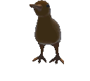

import {
    Callout,
    Collapsible,
    Tabs
} from "report-maker";

# Callout

Admonition-style boxes, heavily inspired by Markdown notes — six variants, an optional `title`, and any content as children:

:::callout
Default — communicate anything.
:::

:::callout{type="info"}
Add context, non-critical.
:::

:::callout{type="tip"}
Suggest something, or give a hint to the reader.
:::

:::callout{type="warning" title="Before continuing"}
Make sure your configuration is backed up.
:::

:::callout{type="caution"}
This operation cannot be undone.
:::

:::callout{type="important"}
Remember this for later.
:::

<Collapsible>
```mdx bar name="report.mdx"
import { Callout } from "report-maker"
```

```tsx bar name="Callout.tsx"
type CalloutProps = {
    type?: "note" | "info" | "tip" | "warning" | "caution" | "important"; // "note" by default
    title?: string;       // defaults to the type's name
    children: ReactNode;  // anything — text, Markdown, or other components
};
```

<Tabs>
    <Tabs.Item label="Exemple">
        <Callout type="warning" title="Before continuing">
            Make sure your configuration is backed up.
        </Callout>
    </Tabs.Item>
    <Tabs.Item label="Code">
        ```mdx
        <Callout type="warning" title="Before continuing">
            Make sure your configuration is backed up.
        </Callout>
        ```
    </Tabs.Item>
</Tabs>

Callouts accept any JSX as children, not just text — including other components:

<Tabs>
    <Tabs.Item label="Exemple">
        <Callout type="important" title="Complex callout">
            A callout with more than simple `text`.
            <Collapsible title="Hidden message">
                
            </Collapsible>
        </Callout>
    </Tabs.Item>
    <Tabs.Item label="Code">

        ```mdx
        <Callout type="important" title="Complex callout">
            A callout with more than simple <Code>text</Code>.
        
            <Collapsible title="Hidden message">
                
            </Collapsible>
        </Callout>
        ```
    </Tabs.Item>
</Tabs>
</Collapsible>
