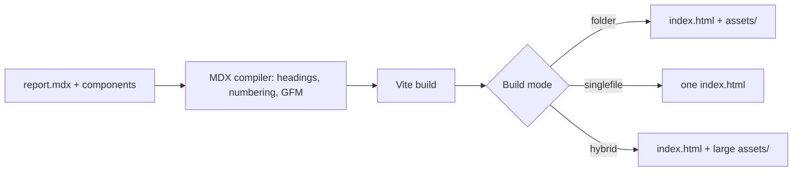
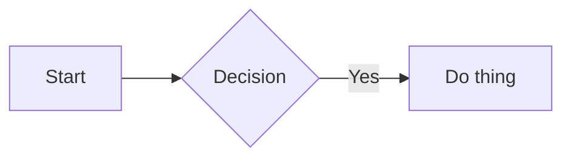
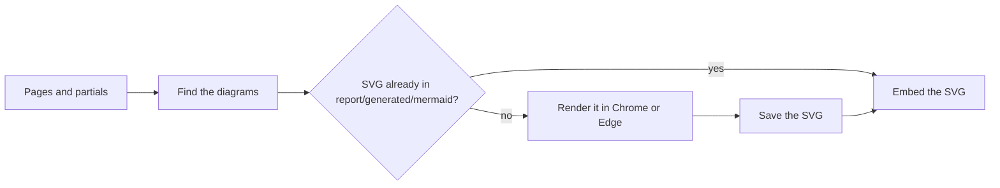

import { Collapsible } from "@report-maker";

# Writing a diagram

Diagrams are rendered as SVG — flowcharts, class diagrams, Gantt charts, git graphs, pie charts, mindmaps, anything Mermaid supports. Write the diagram in a plain `mermaid` fence:



The source of the diagram above is:

````mdx

````

Mermaid supports its own theming via `%%{init: {...}}%%` at the top of a chart — see Mermaid's own documentation for the full set of `themeVariables`.

# How it works

A diagram is never drawn by the report itself. Each one is an **SVG file** that is generated once, saved in `report/generated/mermaid/`, and embedded in the page. A build therefore never contains `mermaid.js`: it only carries the SVGs of the diagrams your pages actually use, and they show up instantly, without a loading flash.



You don't have to do anything for this to happen:

- **Finding the diagrams.** Every page is parsed, and so is every partial it `::include`s, so a diagram in a partial is found like any other.
- **Identifying a diagram.** Each diagram gets a key, a short hash of its normalized source. Its SVG is `report/generated/mermaid/<key>.svg`. Edit a diagram and its key changes: the new SVG is generated, and the old one is reported as unused.
- **Rendering the missing ones.** A headless Chrome, Edge or Chromium loads the `mermaid` package of the project and renders every diagram that has no SVG yet. It is the same Mermaid as the one used live in dev, so the result is the same.

## In dev

When `npm run dev` starts, and every time an `.mdx` file is added, changed or removed, the missing SVGs are rendered in the background. **You don't need to open a page for its diagrams to be generated.**

On top of that, the page you are looking at renders each diagram live in your browser with the real `mermaid` package, so syntax errors show up while you type. The SVG it produces is sent back to the dev server and saved, which replaces the generated one.

## In a build

Before bundling, the missing SVGs are rendered the same way. Then only the SVGs used by the pages are embedded. A diagram that can't be rendered is reported with a warning and the report shows an error in place of it.

# Requirements

Rendering needs a browser already installed on the machine — nothing is downloaded. It is looked up in this order:

1. the `browserPath` option of `mermaidPlugin({ browserPath })` in `build/index.ts`;
2. the `REPORT_MERMAID_BROWSER`, `CHROME_PATH` or `PUPPETEER_EXECUTABLE_PATH` environment variables;
3. the usual install locations of Chrome, Edge and Chromium (Windows, macOS, Linux).

If none is found, the console tells you so and how to point to one. The renderer itself is `puppeteer-core`, a dev dependency: it never reaches `dist/`.

:::callout{type="important" title="Commit report/generated/"}
The generated SVGs are inputs of the build. If you commit them, anyone can build the report without a browser installed — a browser is then only needed to add or change a diagram.
:::

<Collapsible>
You don't need `<Mermaid>` at all: plain triple-backtick `mermaid` fences are intercepted in `src/app/overrides.tsx` and rendered the same way. The component is still available:

```tsx bar name="Mermaid.tsx"
type MermaidProps = {
    chart: string; // raw Mermaid diagram source
};
```

A diagram whose source isn't a static string (`<Mermaid chart={someVariable} />`) can't be found by the build, so it can't be pre-rendered. Use a fence, or a string literal.

## Messages you may see

| Message | Meaning |
| --- | --- |
| `no Chrome / Edge / Chromium found` | No browser was located. Install one or give its path (see above). |
| `could not render <key>` | Mermaid rejected the diagram, almost always a syntax error. The pages using it are listed. |
| `<key>.svg could not be found` | The build ended without an SVG for this diagram: fix the error above it, then rebuild. |
| `<key>.svg isn't used by any page` | The diagram was edited or removed. The file is not bundled; delete it to keep the folder clean. |
| `is not a static string` | A `<Mermaid chart={…}>` that can't be pre-rendered. |

## Where the code lives

All of it is in `build/mermaid/`, one file per job:

| File | Job |
| --- | --- |
| `plugin.ts` | The Vite plugin, which wires the others together. |
| `collect.ts` | Finds the diagrams in the pages and their partials. |
| `svg-store.ts` | The `report/generated/mermaid/` folder: names, listing, writing. |
| `browser.ts` | Finds the browser and the `mermaid` bundle to load. |
| `render.ts` | Renders the missing SVGs. |
| `runtime.ts` | The virtual module used by `Mermaid.tsx`: live in dev, SVGs in a build. |
| `dev-api.ts` | The endpoint where the live renderer saves its SVGs. |
| `dev-watch.ts` | Renders the missing SVGs when the dev server starts and when an `.mdx` changes. |
| `report.ts` | Warnings and summary at the end of a build. |
</Collapsible>