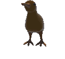
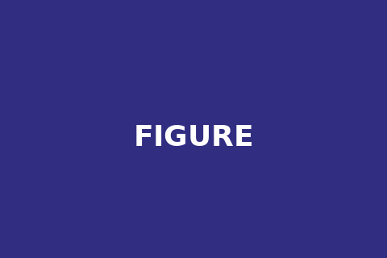
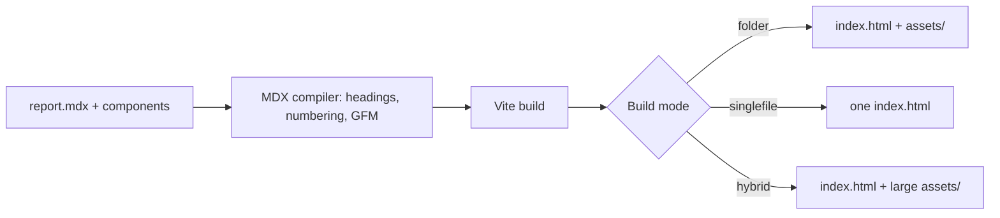
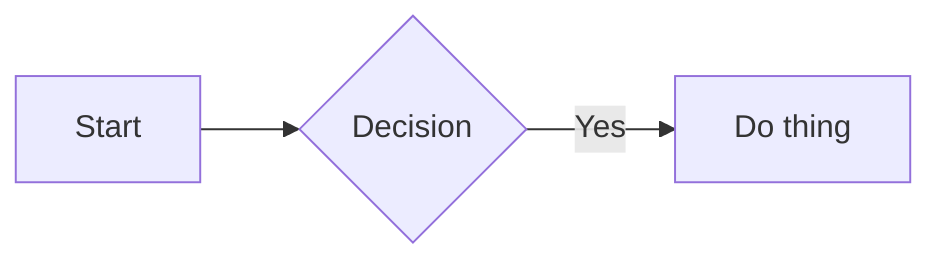

import guideAfter from "./assets/guide-placeholder-after.png";
import guideBefore from "./assets/guide-placeholder-before.png";
import {
    Comparison,
    Callout,
    Collapsible,
    Tabs,
    Term,
    Figure,
    Link
} from "report-maker";

# Introduction

Report Maker is a project that allows you to create a report using MDX file: plain Markdown for the text, real React components wherever Markdown alone isn't enough. Headings number themselves, a table of contents builds itself, and the whole thing can compile down to a single `index.html` (just like a pdf) with no extra runtime.

:::callout{type="info" title="How to read this guide"}
This document is itself a Report Maker report — every component shown below is demonstrated
live, not just described. Open its source file alongside this rendered version if you want to
see the exact MDX behind each example.
:::

In this report, we'll go over what Report Maker needs to run on your machine, how to use it, and everything that can be done with it (spoiler: basically **anything**).

::separator{label="Getting Started"}

# Getting Started

## Prerequisites

- **Node.js 20.19+ or 22.12+** (the minimum of Vite 8, which builds your report)
- **npm** (or an equivalent package manager — examples below use npm)
- A code editor with TypeScript/MDX support (most modern editors handle both out of the box)

<Collapsible title="Why these specific versions?">
    Vite 8 (built on Rolldown) and the MDX/rehype toolchain used here rely on modern ESM resolution.
    Older Node versions don't resolve those packages at all, and fail right away with import errors
    that have nothing to do with your actual report content. Run `node -v` to check yours.
</Collapsible>

---

## Clone & Install

<Tabs>
    <Tabs.Item label="HTTPS">
        ```bash bar copy name="terminal"
        git clone https://github.com/Frozen1753/report-maker.git my-report
        ```
    </Tabs.Item>
    <Tabs.Item label="SSH">
        ```bash bar copy name="terminal"
        git clone git@github.com:Frozen1753/report-maker.git my-report
        ```
    </Tabs.Item>
</Tabs>

Then install dependencies and start the dev server:

```bash bar copy name="terminal"
cd my-report
npm install
npm run dev
```

<Collapsible title="Starting a report without keeping this repo's history">
Use `degit` to copy the files without any git history:

```bash copy
npx degit Frozen1753/report-maker my-report
```

Or click `Use this template` on the GitHub repository page — it creates a fresh repo with the same starting files.

Either way, you won't have a path back to this repo's future updates. If you'd rather keep that option open, clone or fork instead (see below).

</Collapsible>

<Collapsible title="Pulling in updates later">
  If you forked the repo on GitHub, its `Sync fork` button handles it for you. If you cloned it directly, add this repo as a second remote once, then rebase onto it whenever you want the latest fixes:

```bash bar copy name="terminal"
git remote add upstream https://github.com/Frozen1753/report-maker.git
git fetch upstream
git rebase upstream/main
```

A `degit` copy or a repo created from `Use this template` has no shared history with this one, so neither option above applies to it — you'd be copying changes over by hand.

</Collapsible>

::separator{label="Project Layout"}

# Project Layout

Everything you edit lives in one folder: `report/`. The rest of the project exists to turn it into a finished report — you can leave it alone until you want to build your own components or change how things compile.

```
report/                    <- YOUR zone. Everything you edit lives here.
  report.mdx               <- your content. You'll live in this file.
  report.config.tsx        <- title, cover page and header
  assets/                  <- images, gifs, videos you import into report.mdx
  custom/
    glossary.tsx           <- the terms behind :term[...]
    mdx-components.ts      <- optional: extra MDX components
  theme.css                <- your color overrides (written by the theme editor)
  assets.config.json       <- which assets stay external in "hybrid" builds
  generated/mermaid/       <- pre-rendered diagrams. Commit them.
  favicon.svg

src/core/                  <- the engine: components, styles, utilities
src/app/                   <- the page around your report: header, cover, buttons, dev panels
build/                     <- Vite configuration and plugins (Mermaid, Shiki, theme, export...)
```

:::callout{type="tip"}
`theme.css` and `assets.config.json` don't have to be edited by hand — both have a live panel in dev mode instead. See [the theme editor](#live-theme-editor) and [the export panel](#the-export-panel).
:::

## report.config.tsx

The title, the cover page and the header are configured in one place, as plain data — there is no component to edit:

```tsx bar name="report/report.config.tsx"
import { defineReport } from "report-maker";
import MyLogo from "./assets/logo.svg?react";

export default defineReport({
  title: "My report",

  cover: {
    media: {
      content: <MyLogo width={256} height={256} />,
      href: "https://github.com/your-org/your-repo",
      ariaLabel: "Project logo",
    },
    date: "September 2026",
    authors: [{ firstName: "Jane", lastName: "Doe", href: "https://github.com/..." }],
    affiliations: ["Your team or organization"],
  },
});
```

Only `title` is required. It is the browser tab's title, and the default title of the header and of the cover page.

### Cover page

The title page rendered before your report's content: title, date, authors, and an optional piece of media (a logo, an icon, a cover image).

<Collapsible title="En savoir plus">
```tsx bar name="ReportConfig"
type ReportConfig = {
    title: string;
    cover?: {
        title?: string;       // the report title by default
        media?: {
            content: ReactNode;  // an image, icon, logo — anything
            href?: string;       // wraps the media in a link, when set
            ariaLabel?: string;
        };
        date?: string;         // today's date by default
        authors?: {
            firstName?: string;
            lastName?: string;
            alias?: string;      // shown in parentheses after the name
            href?: string;       // wraps the author's name in a link
        }[];
        affiliations?: string[];
    };
    header?: { /* see below */ };
};
```
</Collapsible>

### Header

The sticky bar shown above the report content. Without any configuration it shows the report title and the Report Maker logo.

<Collapsible title="En savoir plus">
```tsx bar name="report/report.config.tsx"
header: {
    title: "My report",    // the report title by default
    logo: <MyLogo />,      // defaults to the Report Maker logo
    logoAlt: "My logo",    // "Logo" by default — accessible label for the logo
},
```

Pass your own `logo` once you no longer need the default Report Maker branding.
</Collapsible>

::separator{label="MDX"}

# Writing Content in MDX

An `.mdx` file is Markdown that also understands JSX. Anything that isn't a component is just Markdown — headings, **bold**, _italics_, lists, tables, links, all of it.

## Numbering & Table of Contents

Every `<hX>` you write gets numbered and anchored automatically — that's what produces the "1.", "1.1", "2." numbering you see throughout this guide. You never write the numbers yourself:

```mdx
# Title One         <- becomes "1 Title One"
## A sub-section    <- becomes "1.1 A sub-section"
# Title Two         <- becomes "2 Title Two"
```

The same mechanism exports a `toc` array from your compiled MDX module, so the table of contents builds itself from whatever headings actually exist in the file — add, remove, or reorder headings in `report.mdx` and it follows, nothing to update by hand:

```tsx bar name="src/app/App.tsx"
import Report, { figures, toc } from "../../report/report.mdx";

<TableOfContent items={toc} />
<ListOfFigures items={figures} />
```

Figures work the same way: `<Figure>`s are numbered in reading order at compile time, and the `figures` export builds the list of figures, with nothing to configure either.

<Collapsible title="How the numbering actually works">
    A remark plugin walks the Markdown AST once per file, keeping a running counter per heading
    depth. It resets deeper counters whenever a shallower heading appears (a new `h1`{" "}
    resets `h2`/`h3`/... back to zero) and writes the computed number as a
    slug + visible prefix directly on each heading — no manual bookkeeping, no renumbering when you
    reorder sections.
</Collapsible>

---

## Two Syntaxes

Components can be written as JSX, or — for the ones that have a directive form — with colons, which reads closer to Markdown:

| Kind        | Syntax                              | Example                              |
| ----------- | ----------------------------------- | ------------------------------------ |
| Block       | `:::name{attributes}` ... `:::`     | `:::callout{type="tip"}`             |
| Single line | `::name{attributes}`                | `::separator{label="Chapter 2"}`     |
| Inline      | `:name[text]{attributes}`           | `:link[docs]{href="#link"}`          |

At the moment `callout`, `separator`, `link` and `term` have a directive form. Code and diagrams use plain Markdown fences, and everything else (`Tabs`, `Collapsible`, `Comparison`, `Figure`) is JSX. Directive attributes are always strings.

:::callout{type="caution" title="A colon followed by a word is a directive"}
Text like `note:foo` would be read as the directive `foo`. To write a literal colon-word, escape the colon: `\:foo`.
:::

---

## Importing Assets

Images, gifs, and videos are real imports, not plain string paths — that's what lets the build pipeline hash them, inline them in `singlefile` mode, or keep them external in `hybrid` mode:

```mdx
import myScreenshot from './assets/screenshot.png'

<Figure caption="...">
    
</Figure>
```

Feel free to organize the `assets/` folder however you like, grouping files into sub-folders or by naming convention — you just need the right path when importing them.

:::callout{type="warning" title="Avoid plain string paths"}
    Writing `src="./assets/screenshot.png"` directly (instead of importing it) means the
    bundler never sees the file — it won't be hashed, won't be inlined in singlefile builds, and
    will likely 404 once the report is actually deployed somewhere other than exactly where you
    tested it.
:::

::separator{label="Components"}

# Components

Each component below shows a live example first. Look inside its "En savoir plus" for the full prop list and more variants.

## Link

Use `Link` for internal references and external URLs. Internal links open in the current tab; external links open in a new tab.

```tsx
<Link href="#link">Link to this document section</Link>
```

You can also use the directive syntax:

```mdx
:::link{href="#link"}
Link to this document section
:::
```

Or place a link directly within a sentence:

```mdx
You can put a :link[link]{href="#link"} in the middle of text.
```

Standard Markdown links work too:

```md
[Link to this document section](#link)
```

<Collapsible title="En savoir plus">

Import `Link` when you want to use it as a JSX component:

```tsx
import { Link } from "report-maker";
```

Its `href` determines how the link behaves:

- **Internal links**, such as `#getting-started` or `/guide`, open in the current tab.
- **External links**, such as `https://example.com`, open in a new tab with `noopener noreferrer`.

`Link` also accepts standard anchor attributes, such as `className` and `aria-label`.

<Tabs>
  <Tabs.Item label="Exemple">
    <Link href="https://example.com" aria-label="Visit Example.com" icon>
      Visit Example.com
    </Link>
    See the link section by clicking :link[here]{href="#link" icon=true}.
  </Tabs.Item>
  <Tabs.Item label="Code">
    ```mdx
    <Link href="https://example.com" aria-label="Visit Example.com" icon>
      Visit Example.com
    </Link>
    See the link section by clicking :link[here]{href="#link" icon=true}.
    ```
  </Tabs.Item>
</Tabs>

Standard Markdown links like `[label](href)` are automatically rendered using `Link`, so internal and external links get the same behavior without extra syntax.

</Collapsible>

## Callout

Admonition-style boxes, heavily inspired by Markdown notes — six variants, an optional `title`, and any content as children:

:::callout
Default — communicate anything.
:::

:::callout{type="info"}
Add context, non-critical.
:::

:::callout{type="tip"}
Suggest something, or give a hint to the reader.
:::

:::callout{type="warning" title="Before continuing"}
Make sure your configuration is backed up.
:::

:::callout{type="caution"}
This operation cannot be undone.
:::

:::callout{type="important"}
Remember this for later.
:::

<Collapsible title="En savoir plus">
```mdx bar name="report.mdx"
import { Callout } from "report-maker"
```

```tsx bar name="Callout.tsx"
type CalloutProps = {
    type?: "note" | "info" | "tip" | "warning" | "caution" | "important"; // "note" by default
    title?: string;       // defaults to the type's name
    children: ReactNode;  // anything — text, Markdown, or other components
};
```

<Tabs>
    <Tabs.Item label="Exemple">
        <Callout type="warning" title="Before continuing">
            Make sure your configuration is backed up.
        </Callout>
    </Tabs.Item>
    <Tabs.Item label="Code">
        ```mdx
        <Callout type="warning" title="Before continuing">
            Make sure your configuration is backed up.
        </Callout>
        ```
    </Tabs.Item>
</Tabs>

Callouts accept any JSX as children, not just text — including other components:

<Tabs>
    <Tabs.Item label="Exemple">
        <Callout type="important" title="Complex callout">
            A callout with more than simple `text`.
            <Collapsible title="Hidden message">
                
            </Collapsible>
        </Callout>
    </Tabs.Item>
    <Tabs.Item label="Code">

        ```mdx
        <Callout type="important" title="Complex callout">
            A callout with more than simple <Code>text</Code>.
        
            <Collapsible title="Hidden message">
                
            </Collapsible>
        </Callout>
        ```
    </Tabs.Item>
</Tabs>
</Collapsible>

---

## Collapsible

Keeps optional detail out of the main reading flow — you've likely clicked a few already while reading this guide.

<Collapsible title="Closed by default">
    Stays collapsed until clicked. Good for methodology details, edge cases, or anything a skimming
    reader can safely skip.
</Collapsible>

<Collapsible title="Open by default" open>
    Pass the `open` prop to start expanded — for content that's optional to read in depth
    but important enough that a reader shouldn't miss it exists.
</Collapsible>

<Collapsible title="En savoir plus">
```mdx bar name="report.mdx"
import { Collapsible } from "report-maker"
```

```tsx bar name="Collapsible.tsx"
type CollapsibleProps = {
    title?: string;       // shown as the clickable summary
    open?: boolean;       // starts expanded when true (false by default)
    children: ReactNode;  // anything — text, Markdown, or other components
};
```

<Tabs>
    <Tabs.Item label="Exemple">
        <Collapsible title="My titled collapsible">
            Any content works here.
        </Collapsible>
    </Tabs.Item>
    <Tabs.Item label="Code">
        ```mdx
        <Collapsible title="My titled collapsible">
            Any content works here.
        </Collapsible>
        ```
    </Tabs.Item>
</Tabs>

Collapsibles accept any JSX too — including other components:

<Tabs>
    <Tabs.Item label="Exemple">
        <Collapsible title="Complex collapsible">
            More than simple `text`.
            
            <Callout type="tip">
                Callouts nest fine too, since they're just JSX.
            </Callout>
        </Collapsible>
    </Tabs.Item>
    <Tabs.Item label="Code">
        ```mdx
        <Collapsible title="Complex collapsible">
            More than simple `text`.
            
            <Callout type="tip">
                Callouts nest fine too, since they're just JSX.
            </Callout>
        </Collapsible>
        ```
    </Tabs.Item>
</Tabs>

</Collapsible>

---

## Separator

A plain rule (equivalent to `---` in Markdown), or a labeled break between sections.

::separator{label="example"}

<Collapsible title="En savoir plus">

```mdx bar name="Separator.tsx"
type SeparatorProps = {
    label?: string;  // text shown between the two lines
};
```

<Tabs>
    <Tabs.Item label="Exemple">
        ---
    </Tabs.Item>
    <Tabs.Item label="Code">
       ```mdx
       ---
       ```
    </Tabs.Item>
</Tabs>

<Tabs>
    <Tabs.Item label="Exemple">
        ::separator{label="my text here"}
    </Tabs.Item>
    <Tabs.Item label="Code">
        ```mdx
        ::separator{label="my text here"}
        ```
        **OR**
        ```mdx
        import { Separator } from "report-maker" {/* At the top */}

        <Separator label="my text here" /> {/* Where you need it */}
        ```
    </Tabs.Item>
</Tabs>
</Collapsible>

---

## Tabs

Groups mutually-exclusive content — alternative commands, alternative approaches, anything where showing every option at once would be noise:

<Tabs>
    <Tabs.Item label="Option A">
        Content for the first tab. Any JSX works here, not just text.
    </Tabs.Item>
    <Tabs.Item label="Option B">
        ```bash copy
        echo "tab content can be a whole code block"
        ```
    </Tabs.Item>
</Tabs>

<Collapsible title="En savoir plus">
```mdx bar name="report.mdx"
import { Tabs } from "report-maker"
```

```tsx bar name="Tabs.tsx"
type TabsProps = {
    children: ReactNode;      // <Tabs.Item> elements
    defaultActive?: number;   // index of the tab opened first (0 by default)
    className?: string;
};

type TabItemProps = {         // <Tabs.Item ...>
    label: ReactNode;         // the tab's title
    children: ReactNode;      // the panel content
    disabled?: boolean;
};
```

```mdx
<Tabs>
  <Tabs.Item label="Option A">Content for the first tab.</Tabs.Item>
  <Tabs.Item label="Option B">Content for the second tab.</Tabs.Item>
</Tabs>
```
</Collapsible>

---

## Comparison

A toggle between two states — screenshots, code, anything comparable. It's literally a 2-tab `Tabs` underneath, just make sure to wrap images/gifs in `` and videos in `<video controls>`:

<Comparison>
  <Comparison.Left label="Before">
    
  </Comparison.Left>

  <Comparison.Right label="After">
    
  </Comparison.Right>
</Comparison>

<Collapsible title="En savoir plus">
```mdx bar name="report.mdx"
import { Comparison } from "report-maker"
```

```tsx bar name="Comparison.tsx"
export type ComparisonProps = {
    children: ReactNode;
};

export type ComparisonItemProps = {
    children: ReactNode;
    label?: string;
};
```

```tsx
<Comparison>
  <Comparison.Left label="Before">
    
  </Comparison.Left>

  <Comparison.Right label="After">
    
  </Comparison.Right>
</Comparison>
```

`<Comparison.Left>` and `<Comparison.Right>` accept any JSX, not just images (their labels default to `"Before"` and `"After"`) — a `Code` block on each side works just as well for comparing two versions of a snippet.
</Collapsible>

---

## Figure

An image, gif, or video with a numbered caption, and an optional lightbox (with pinch-to-zoom and drag-to-pan once opened):

<Figure>
    <Figure.Media>
        
    </Figure.Media>
    <Figure.Caption>
        This is my caption
    </Figure.Caption>
    <Figure.Lightbox>
        Anything can go here: a higher-resolution version, extra context...
    </Figure.Lightbox>
</Figure>

<Collapsible title="En savoir plus">
```mdx bar name="report.mdx"
import { Figure } from "report-maker"
```

```tsx bar name="Figure.tsx"
type FigureProps = {
    children: ReactNode;  // <Figure.Media>, <Figure.Caption> and <Figure.Lightbox>
    lightbox?: boolean;   // click-to-zoom on the media itself (false by default)
    className?: string;
};
```

`<Figure.Media>` is required; `<Figure.Caption>` and `<Figure.Lightbox>` are optional. Writing a `<Figure.Lightbox>` turns the lightbox on by itself, and what it contains is shown instead of the media — extra context, a higher-resolution version, or an entirely different element:

```mdx
<Figure>
  <Figure.Media>
    
  </Figure.Media>
  <Figure.Caption>My **caption**, with `Markdown`</Figure.Caption>
  <Figure.Lightbox>
    
  </Figure.Lightbox>
</Figure>
```

Videos work the same way, just put a `<video controls>` in `<Figure.Media>` — captions and numbering behave identically.

Figures are numbered at compile time, in reading order, so there is nothing to wrap in a provider. The same pass exports the `figures` array behind the list of figures at the top of this guide.
</Collapsible>

---

## Code

Two types: `inline`, for short references like file names or commands inside a sentence — for example `npm run dev` sits right in the flow — and `bloc`, for actual code:

```ts
interface Report {
  title: string
  sections: Section[]
}
```

<Collapsible title="En savoir plus">

```tsx bar name="Code.tsx"
type CodeProps = {
    type?: "inline" | "bloc";  // "inline" by default
    lang?: string;             // any language Shiki supports — "bloc" only
    bar?: boolean;             // shows a header bar with the file name
    name?: string;             // file name shown in the bar
    copy?: boolean;            // adds a copy-to-clipboard button
    children: ReactNode;
};
```

Add a header bar with a file name and a copy button when it's worth labeling:

```bash bar copy name="terminal"
npm run build:hybrid
```

Blocks are highlighted by Shiki **at build time**, so no Shiki, WASM or grammar ends up in the final report. A block whose language or content isn't a static string (a `{...}` expression containing `${}`, say) can't be read by the build: it renders as plain text, and the build prints a warning for each one. In dev mode, blocks are highlighted live, with every Shiki language and theme available.
</Collapsible>

---

## Mermaid

Diagrams rendered live as SVG — flowcharts, class diagrams, Gantt charts, git graphs, pie charts, mindmaps, anything Mermaid supports:



<Collapsible title="En savoir plus">
```tsx bar name="Mermaid.tsx"
type MermaidProps = {
    chart: string; // raw Mermaid diagram source
};
```

````mdx

````

Mermaid supports its own theming via `%%{init: {...}}%%` at the top of a chart — see Mermaid's own documentation for the full set of `themeVariables`.

Diagrams are **pre-rendered**. In dev mode each diagram is rendered live by the `mermaid` package, so syntax errors show up while you type, and the resulting SVG is saved to `report/generated/mermaid/`. A build never contains `mermaid.js`: it only embeds those SVGs. So after adding or changing a diagram, run `npm run dev`, open the report once, then build.

:::callout{type="important" title="Commit report/generated/"}
The build can't render a diagram by itself. If an SVG is missing, the build prints a warning and the report shows an error in place of the diagram. A diagram whose source isn't a static string (`<Mermaid chart={someVariable} />`) can't be pre-rendered either.
:::

You don't need `<Mermaid>` at all: plain triple-backtick `mermaid` fences are intercepted in `src/app/overrides.tsx` and rendered the same way.
</Collapsible>

---

## Term

An inline word with a tooltip attached — for definitions, jargon, or anything a reader might want explained without leaving the sentence. It's drawn with a dotted underline: hover :term[latency] (or Tab to it) and the tooltip appears after a short delay. For words you reuse, define them once in [the glossary](#glossary).

:::callout{type="tip" title="Pin a tooltip"}
Hover a term, then **middle-click** it or its tooltip to pin it open — its border gets stronger to show it. Click anywhere else to close it.
:::

<Collapsible title="En savoir plus">
```mdx bar name="report.mdx"
import { Term } from "report-maker"
```

```tsx bar name="Term.tsx"
type TermProps = {
    tooltip: ReactNode;   // anything — text, Markdown, or other components
    children: ReactNode;  // the visible term
    openDelay?: number;   // ms before showing on hover (300 by default)
    closeDelay?: number;  // ms before hiding once the pointer leaves (100 by default)
};
```

<Tabs>
    <Tabs.Item label="Exemple">
        Hover <Term tooltip={<>Time between a request and its response.</>}>latency</Term> to read its definition.
    </Tabs.Item>
    <Tabs.Item label="Code">
        ```mdx
        Hover <Term tooltip={<>Time between a request and its response.</>}>latency</Term> to read its definition.
        ```
    </Tabs.Item>
</Tabs>

The tooltip accepts any JSX, not just text — including other components:

<Tabs>
    <Tabs.Item label="Exemple">
        <Term tooltip={<Callout type="tip">Callouts work in a tooltip too.</Callout>}>
            Hover me
        </Term>
        .
    </Tabs.Item>
    <Tabs.Item label="Code">
        ```mdx
        <Term tooltip={<Callout type="tip">Callouts work in a tooltip too.</Callout>}>Hover me</Term>
        ```
    </Tabs.Item>
</Tabs>

### Nesting

A tooltip can contain terms of its own, as deep as you like — a term, in a term, in a term:

<Tabs>
    <Tabs.Item label="Exemple">
        <Term tooltip={<>Time between a <Term tooltip={<Collapsible>A request is a <Term tooltip={<>If you don't know what this is, you suck.</>}>network</Term> thing.</Collapsible>}>request</Term> and its response.</>}>latency</Term>
    </Tabs.Item>
    <Tabs.Item label="Code">
        ```mdx
        <Term tooltip={<>Time between a <Term tooltip={<Collapsible>A request is a <Term tooltip={<>If you don't know what this is, you suck.</>}>network</Term> thing.</Collapsible>}>request</Term> and its response.</>}>latency</Term>
        ```
    </Tabs.Item>
</Tabs>

When a nested tooltip opens, the one that contains it is **pinned automatically**, so the whole chain stays on screen while you read down it. A click anywhere outside the chain closes every pinned tooltip at once. Closing a tooltip always closes the ones nested inside it.

### Controls

- **Hover** a term to open its tooltip after `openDelay`. The pointer can move onto the tooltip without it closing, so its content stays readable and clickable.
- **Tab** to a term to open its tooltip immediately.
- **Middle-click** a term or a tooltip to pin it. A pinned tooltip ignores the pointer leaving and only closes on an outside click.
- **Escape** closes the innermost open tooltip.

Any number of tooltips can be pinned at the same time, including from different terms.

:::callout{type="warning" title="Keep tooltips light"}
Pinning is mouse-only, so keyboard and touch readers can't pin a tooltip. A tooltip also closes as soon as keyboard focus leaves its term, which means links or buttons inside one are out of keyboard reach. Put anything essential in the page itself, and use tooltips for supporting detail only. Also avoid placing a `Term` inside a link or a button: it is focusable itself.
:::
</Collapsible>

::separator{label="Glossary"}

# Glossary

Writing `<Term tooltip={...}>` every time gets heavy once the same word shows up in several places. The glossary lets you define a term once, then use it anywhere with a single directive: hover :term[latency] (or Tab to it) and its tooltip appears, exactly like a regular `Term`.

:::callout{type="tip" title="Case and accents don't matter"}
:term[Latency] and :term[LATENCY] both find the same definition. The term is displayed exactly as you typed it, so it fits the sentence around it.
:::

<Collapsible title="En savoir plus">

## Defining a term

Definitions live in `report/custom/glossary.tsx`, away from the report content. The tooltip is regular JSX, so anything that works in a `Term` works here — import what you need at the top of the file.

```tsx bar name="report/custom/glossary.tsx"
import type { GlossaryEntries } from "report-maker";

export const terms = {
  latency: <>Time between a request and its response.</>,
} satisfies GlossaryEntries;
```

:::callout{type="note"}
`src/app/overrides.tsx` hands this object to the report. If a term you defined shows up as `UNKNOWN_TERM`, check that it is spelled the same in the glossary and in the report.
:::

## Using a term

Put the word in brackets after a colon:

<Tabs>
    <Tabs.Item label="Exemple">
        Hover :term[latency] to read its definition.
    </Tabs.Item>
    <Tabs.Item label="Code">
        ```mdx
        Hover :term[latency] to read its definition.
        ```
    </Tabs.Item>
</Tabs>

## Matching

- **Case** is ignored: `:term[Latency]` and `:term[LATENCY]` are the same term.
- **Accents and ligatures** are ignored: a term defined as `événement` is found by `Evenement`, and `cœur` by `coeur`.
- **Extra spaces** are ignored: `:term[ Time   out ]` finds the term `time out`. Typographic apostrophes (`’`) match plain ones.
- **The word you write is the text shown**, unless you give an `id`. Other forms of a word (a plural, say) aren't matched automatically: put the term to look up in `id`, and the text to display in the brackets.

<Tabs>
    <Tabs.Item label="Exemple">
        Many :term[latencies]{id=latency} add up.
    </Tabs.Item>
    <Tabs.Item label="Code">
        ```mdx
        Many :term[latencies]{id=latency} add up.
        ```
    </Tabs.Item>
</Tabs>

## Nesting

A definition can use other terms, just like nested `Term` components, with `GlossaryTerm` in the glossary file:

```tsx bar name="report/custom/glossary.tsx"
network: <>Computers talking to each other through <GlossaryTerm id="request">requests</GlossaryTerm>.</>,
request: <>A request is a <GlossaryTerm id="network" /> thing.</>,
latency: <>Time between a <GlossaryTerm id="request" /> and its response.</>,
```

:::callout{type="note" title="Order doesn't matter"}
Terms are looked up when a tooltip opens, not when it is defined. You can define `latency` before `request`, and two terms can even refer to each other.
:::

:::callout{type="caution" title="Unknown terms"}
Asking for a term that was never defined renders a bold `UNKNOWN_TERM` in the report and logs `unknown term: ...` as an error in the browser console. Builds strip console output, so the bold marker is the signal that stays.
:::

:::callout{type="warning" title="Duplicate words"}
Words that only differ by case, accents or spacing count as the same word, so `Événement` and `evenement` collide: the last one defined wins, without any warning.
:::

<Collapsible title="Why not defining everything at the top of the MDX?">
  You could write each tooltip at the start of `report.mdx` and use it with `<Term>`. It works, but it mixes logic with content: the report gets longer before the first sentence, and the definitions can't be shared with another report. A separate glossary keeps `report.mdx` readable and keeps every definition in one place.
</Collapsible>
</Collapsible>

::separator{label="Theming"}

# Theming

## CSS Variables

Everything visual is driven by CSS custom properties. The defaults live in `src/core/styles/tokens.css`; your own values live in `report/theme.css`, loaded after it, so anything you set there wins:

```css bar name="report/theme.css"
:root {
  --c-primary: #0149ad;
  --c-bg-surface: #fbfbfb;
  --text-h1: 2rem;
}

.dark {
  --c-primary: #6fa3ef;
}
```

Colors are named `--c-*`; sizes and fonts use `--text-*`, `--font-*`, `--radius-*`, `--space-*` and `--transition-*`. Light values live in `:root`, dark values in `.dark`.

:::callout{type="caution" title="A :root value also applies in dark mode"}
`:root` and `.dark` have the same priority, and `report/theme.css` is loaded last. So a color you set in `:root` there also wins in dark mode, unless you set it in `.dark` too (and after `:root`). The theme editor handles this for you; if you edit the file by hand, set both.
:::

## Light / Dark Mode

A theme button ships in the published report itself — it's not a dev tool, it's the one in the corner of this very page:

It follows the reader's system preference until they click it once, then remembers their choice for next time.

:::callout{type="note"}
The very first paint is handled by a small inline script in `index.html`, before React even runs — without it, readers would see a flash of the wrong theme for a split second on every load.
:::

## Live Theme Editor

:::callout{type="important" title="Development only"}
Everything in this section is a dev tool — it appears while running `npm run dev` and is never included in a build. If you're reading a published report, you won't see it.
:::

A floating button opens a panel that writes `report/theme.css`, for both light and dark at once — and only the values that differ from the defaults, so emptying the file brings the default theme back:

- **Colors** get a real color picker (hex, `rgb()`, `rgba()`, `hsl()` are all recognized) plus a separate opacity slider, since colors with transparency need one.
- **Everything else** (sizes, generic values) gets a plain text field.
- Switching the panel's own Light/Dark toggle lets you edit dark-mode overrides specifically — a reset button per row reverts a value back to "same as light."
- Changes preview instantly in the page behind the panel; nothing is written to disk until you click **Save**.

## Code Syntax Theme

Still inside the live theme editor: two comboboxes pick which Shiki theme highlights `<Code type="bloc">` blocks, one for light mode and one for dark mode — independently, so you're not stuck pairing a light code theme with a light report theme. The choice is stored in `report/theme.css` with the rest of your theme.

::separator{label="Building"}

# Building & Exporting

A report compiles to one of three shapes, chosen with an npm script:

| Mode         | Output                                                                | Best for                                                       |
| ------------ | --------------------------------------------------------------------- | -------------------------------------------------------------- |
| `folder`     | `index.html` + a separate `assets/` folder                            | hosting on a server, largest reports                           |
| `singlefile` | one `index.html`, everything inlined (JS, CSS, every image/gif/video) | emailing, sharing a single file                                |
| `hybrid`     | one `index.html`, but large assets stay external                      | single-file convenience without bloating it with a 40 MB video |

```bash bar copy name="terminal"
npm run build:folder
npm run build:singlefile
npm run build:hybrid
```

## Choosing What Stays External

In `hybrid` mode, `report/assets.config.json` decides what gets excluded from the single file:

```json bar name="report/assets.config.json"
{
  "excludeExtensions": [".mp4", ".mov", ".webm", ".gif"],
  "maxImageWidth": 3000,
  "excludeFiles": []
}
```

Anything matching an excluded extension, or an image wider than `maxImageWidth`, is written to `dist/hybrid/assets/` instead of being base64-encoded into the HTML.

## The Export Panel

:::callout{type="important" title="Development only"}
Like the theme editor, this panel is a dev tool — it never ships in a build.
:::

A second floating button runs an actual build without leaving the browser: pick a mode, check off any extensions or oversized images to keep external in `hybrid` mode, and it writes `report/assets.config.json` and runs the matching build script for you — the result lands in `dist/&lt;mode&gt;/` either way.

## Why Builds Stay Small

The two heaviest parts of a report are never shipped:

- **Mermaid diagrams** are rendered in dev mode and saved as SVG, so `mermaid.js` isn't in the build.
- **Code blocks** are highlighted by Shiki while building, so neither Shiki nor its grammars are in the build.

The price is one habit: after adding or changing a diagram, open the report once with `npm run dev` before building. See [Mermaid](#mermaid) and [Code](#code).

::separator{label="Extending"}

# Extending Report Maker

The engine is meant to be extended from `report/`, without touching `src/`.

## Your own components

Import them at the top of `report.mdx`, like any React component:

```mdx
import MyChart from "./custom/MyChart";

<MyChart title="Sales" />
```

To use one without any import — or to replace a built-in one — register it in `report/custom/mdx-components.ts`:

```ts bar name="report/custom/mdx-components.ts"
import type { ElementType } from "react";
import { MyChart } from "./MyChart";

export const components: Record<string, ElementType> = {
  MyChart,         // <MyChart /> works everywhere, no import needed
  chart: MyChart,  // lowercase names also work as directives: :::chart{title="Sales"}
};
```

Built-in directives such as `callout`, `separator`, `link` and `term` work the same way. Directive attributes are strings; pass anything richer through JSX.

## The public API

Everything you can import from `"report-maker"` comes from `src/core/mdx.ts`: the components (`Callout`, `Code`, `Collapsible`, `Comparison`, `Figure`, `Link`, `Mermaid`, `Separator`, `Tabs`, `Term`, `GlossaryTerm`...) and `defineReport`.

<Collapsible title="Keeping the engine clean">
Dependencies go one way:

```
report/  ->  src/app  ->  src/core
```

`src/core` imports nothing from `src/app`, `report/` or `build/`; `src/app` assembles the engine and your report; and `report/` only talks to the engine through `"report-maker"`. A small script checks it:

```bash bar copy name="terminal"
node build/check-boundaries.mjs
```
</Collapsible>

<Collapsible title="What is in build/">
- `mdx/` — the heading numbering and the figure numbering.
- `mermaid/` — diagram pre-rendering.
- `shiki/` — code highlighting at build time.
- `theme/`, `assets/`, `export/` — the dev-only endpoints behind the theme editor and the export panel.
- `index.ts` — assembles the Vite configuration; `vite.config.ts` only calls it.
</Collapsible>


::separator{label="Conclusion"}

# Conclusion

:::callout{type="note" title="Wrap-up"}
Clone, `npm install`, `npm run dev`, write `report/report.mdx` with the components above, set your title and authors in `report/report.config.tsx`, pick a build mode when you're done. That's the whole workflow — everything else is detail you can come back to from this guide when you need it.
:::

## A Note From the Author

I built Report Maker after a friend and I wrote a report by hand last year, in raw HTML and Markdown glued together — the result was genuinely great, but getting there was not an experience I'd wish on anyone. This project is the "never again" version of that.

If you ended up here because someone pointed you at the repo, or because you just stumbled onto it: use it, fork it, strip out whatever you don't need, build your own components on top of it. It's licensed under `MIT` — do basically anything with it, including in things you sell, just keep the license notice around.

If you build something with it, improve on it, or find something I got wrong, I'd like to hear about it — open an issue or a PR on <a href="https://github.com/Frozen1753/report-maker" target="_blank" rel="noopener noreferrer">the repo</a>.

::separator{label="THE END"}
