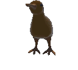
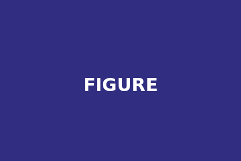
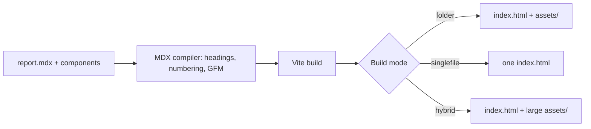
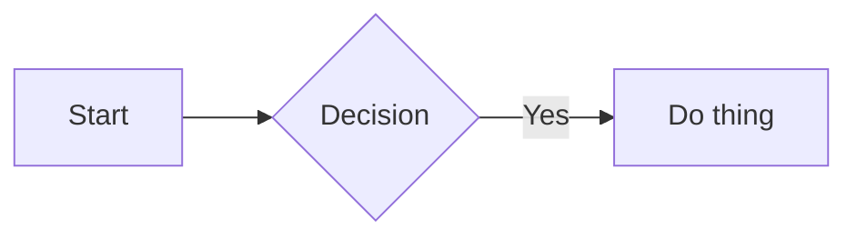

import guideAfter from "./assets/guide-placeholder-after.png";
import guideBefore from "./assets/guide-placeholder-before.png";
import {
    Comparison,
    Callout,
    Collapsible,
    Tabs,
    Term,
    Figure,
} from "./components/mdx";
import { easyTerm } from "./helpers/easy-term";

# Introduction

Report Maker is a project that allows you to create a report using MDX file: plain Markdown for the text, real React components wherever Markdown alone isn't enough. Headings number themselves, a table of contents builds itself, and the whole thing can compile down to a single `index.html` (just like a pdf) with no extra runtime.

:::callout{type="info" title="How to read this guide"}
This document is itself a Report Maker report — every component shown below is demonstrated
live, not just described. Open its source file alongside this rendered version if you want to
see the exact MDX behind each example.
:::

In this report, we'll go over what Report Maker needs to run on your machine, how to use it, and everything that can be done with it (spoiler: basically **anything**).

::separator{label="Getting Started"}

# Getting Started

## Prerequisites

- **Node.js 18 or newer**
- **npm** (or an equivalent package manager — examples below use npm)
- A code editor with TypeScript/MDX support (most modern editors handle both out of the box)

<Collapsible title="Why these specific versions?">
    Vite 5+ and the MDX/rehype toolchain used here rely on modern ESM resolution — older Node
    versions can resolve packages inconsistently, which shows up as confusing build errors that have
    nothing to do with your actual report content. Staying current avoids an entire category of
    debugging.
</Collapsible>

---

## Clone & Install

<Tabs>
    <Tabs.Item label="HTTPS">
        ```bash bar copy name="terminal"
        git clone https://github.com/Frozen1753/report-maker.git my-report
        ```
    </Tabs.Item>
    <Tabs.Item label="SSH">
        ```bash bar copy name="terminal"
        git clone git@github.com:Frozen1753/report-maker.git my-report
        ```
    </Tabs.Item>
</Tabs>

Then install dependencies and start the dev server:

```bash bar copy name="terminal"
cd my-report
npm install
npm run dev
```

<Collapsible title="Starting a report without keeping this repo's history">
Use `degit` to copy the files without any git history:

```bash copy
npx degit Frozen1753/report-maker my-report
```

Or click `Use this template` on the GitHub repository page — it creates a fresh repo with the same starting files.

Either way, you won't have a path back to this repo's future updates. If you'd rather keep that option open, clone or fork instead (see below).

</Collapsible>

<Collapsible title="Pulling in updates later">
  If you forked the repo on GitHub, its `Sync fork` button handles it for you. If you cloned it directly, add this repo as a second remote once, then rebase onto it whenever you want the latest fixes:

```bash bar copy name="terminal"
git remote add upstream https://github.com/Frozen1753/report-maker.git
git fetch upstream
git rebase upstream/main
```

A `degit` copy or a repo created from `Use this template` has no shared history with this one, so neither option above applies to it — you'd be copying changes over by hand.

</Collapsible>

::separator{label="The Report Shell"}

# The Report Shell

`report.mdx` is your content. Everything else in the project exists to turn it into a
finished report — some of it you'll open constantly, some of it basically never. Roughly from most
to least often touched:

```
report.mdx                  <- your content. You'll live in this file.
assets/                     <- images, gifs, videos you import into report.mdx
styles/style.css            <- theme: colors, fonts, light & dark
App.tsx                     <- the frame around your content: cover page, header — see below
report.assets.config.json   <- which assets stay external in "hybrid" builds

scripts/, components/, <- the engine itself. Only touch these if you're
vite.config.ts comfortable with React/Vite and want to build
your own components or change how things compile.
```

:::callout{type="tip"}
`style.css` and `report.assets.config.json` don't have to be edited by
hand — both have a live panel in dev mode instead. See [the theme editor](#live-theme-editor)
and [the export panel](#the-export-panel).
:::

## App.tsx

Trimmed down, it wires together:

- `<Header title="..." />` — the sticky bar, see below.
- `<CoverPage .../>` — the title page, see below.
- `<TableOfContent items={toc} />` — reads the `toc` export straight from
  `report.mdx`, nothing to configure.
- `<FigureProvider>` wrapping `<Report />` — required for
  `<Figure>`'s automatic numbering to work.
- `<TopButton />` — a scroll-to-top button once the reader scrolls down.
- `<ThemeButton />` — the light/dark toggle, see [Theming](#theming).
- `<ExportPanel />` / `<ThemePanel />` — dev-only (
  `import.meta.env.DEV`), see [Theming](#theming) and [Building &
  Exporting](#building-exporting).

:::callout{type="warning" title="Don't remove FigureProvider"}
Every `<Figure>` needs a `<FigureProvider>` somewhere above it for
its automatic numbering to work — remove it and any `<Figure>` throws at render
instead of rendering. `App.tsx` already wraps `<Report />` in one; if
you ever restructure `App.tsx`, make sure that wrapper survives.
:::

<Collapsible title="Writing Mermaid diagrams as plain fences instead of <Mermaid>">
    `App.tsx` also intercepts plain triple-backtick `mermaid` code fences and
    renders them as live diagrams automatically — an alternative to writing{" "}
    `<Mermaid chart={...} />` explicitly. Both produce the same result; pick
    whichever reads better in your source.
</Collapsible>

## CoverPage

The title page rendered before your report's content — title, date, authors, and an optional piece of media (a logo, an icon, a cover image).

<Collapsible title="En savoir plus">
```tsx bar name="CoverPage.tsx"
type CoverPageProps = {
    title?: string;       // "My report" by default
    coverMedia?: {
        content: ReactNode;  // an image, icon, logo — anything
        href?: string;       // wraps coverMedia in a link, when set
        ariaLabel?: string;
    };
    date: string;          // required
    authors?: {
        firstName?: string;
        lastName?: string;
        alias?: string;     // shown in parentheses after the name
        href?: string;      // wraps the author's name in a link
    }[];
    affiliations?: string[];
};
```

```tsx bar name="App.tsx"
<CoverPage
  title="How to use Report Maker?"
  date="September 2026"
  coverMedia={{
    content: <ReportMakerIcon width={256} height={256} />,
    href: "https://github.com/your-org/report-maker",
    ariaLabel: "Report Maker icon",
  }}
  authors={[{ firstName: "Jane", lastName: "Doe", href: "https://github.com/..." }]}
  affiliations={["Your team or organization"]}
/>
```
</Collapsible>

## Header

The sticky bar shown above the report content.

<Collapsible title="En savoir plus">
```tsx bar name="Header.tsx"
type HeaderProps = {
    title?: string;    // "[report title]" by default
    logo?: ReactNode;  // defaults to the Report Maker logo
    logoAlt?: string;  // "Logo" by default — accessible label for the logo
};
```

```tsx bar name="App.tsx"
<Header title="How to use Report Maker?" />
```

Pass your own `logo` once you no longer need the default Report Maker branding.

</Collapsible>

::separator{label="MDX"}

# Writing Content in MDX

An `.mdx` file is Markdown that also understands JSX. Anything that isn't a component is just Markdown — headings, **bold**, _italics_, lists, tables, links, all of it.

## Numbering & Table of Contents

Every `<hX>` you write gets numbered and anchored automatically — that's what produces the "1.", "1.1", "2." numbering you see throughout this guide. You never write the numbers yourself:

```mdx
# Title One         <- becomes "1 Title One"
## A sub-section    <- becomes "1.1 A sub-section"
# Title Two         <- becomes "2 Title Two"
```

The same mechanism exports a `toc` array from your compiled MDX module, so the table of contents builds itself from whatever headings actually exist in the file — add, remove, or reorder headings in `report.mdx` and it follows, nothing to update by hand:

```tsx bar name="App.tsx"
import Report, { toc } from './report.mdx'

<TableOfContent items={toc} />
```

<Collapsible title="How the numbering actually works">
    A remark plugin walks the Markdown AST once per file, keeping a running counter per heading
    depth. It resets deeper counters whenever a shallower heading appears (a new `h1`{" "}
    resets `h2`/`h3`/... back to zero) and writes the computed number as a
    slug + visible prefix directly on each heading — no manual bookkeeping, no renumbering when you
    reorder sections.
</Collapsible>

---

## Importing Assets

Images, gifs, and videos are real imports, not plain string paths — that's what lets the build pipeline hash them, inline them in `singlefile` mode, or keep them external in `hybrid` mode:

```mdx
import myScreenshot from './assets/screenshot.png'

<Figure caption="...">
    
</Figure>
```

Feel free to organize the `assets/` folder however you like, grouping files into sub-folders or by naming convention — you just need the right path when importing them.

:::callout{type="warning" title="Avoid plain string paths"}
    Writing `src="./assets/screenshot.png"` directly (instead of importing it) means the
    bundler never sees the file — it won't be hashed, won't be inlined in singlefile builds, and
    will likely 404 once the report is actually deployed somewhere other than exactly where you
    tested it.
:::

::separator{label="Components"}

# Components

Each component below shows a live example first. Look inside its "En savoir plus" for the full prop list and more variants.

## Callout

Admonition-style boxes, heavily inspired by Markdown notes — six variants, an optional `title`, and any content as children:

:::callout
Default — communicate anything.
:::

:::callout{type="info"}
Add context, non-critical.
:::

:::callout{type="tip"}
Suggest something, or give a hint to the reader.
:::

:::callout{type="warning" title="Before continuing"}
Make sure your configuration is backed up.
:::

:::callout{type="caution"}
This operation cannot be undone.
:::

:::callout{type="important"}
Remember this for later.
:::

<Collapsible title="En savoir plus">
```mdx bar name="report.mdx"
import { Callout } from './components/mdx'
```

```tsx bar name="Callout.tsx"
type CalloutProps = {
    type?: "note" | "info" | "tip" | "warning" | "caution" | "important"; // "note" by default
    title?: string;       // defaults to the type's name
    children: ReactNode;  // anything — text, Markdown, or other components
};
```

<Tabs>
    <Tabs.Item label="Exemple">
        <Callout type="warning" title="Before continuing">
            Make sure your configuration is backed up.
        </Callout>
    </Tabs.Item>
    <Tabs.Item label="Code">
        ```mdx
        <Callout type="warning" title="Before continuing">
            Make sure your configuration is backed up.
        </Callout>
        ```
    </Tabs.Item>
</Tabs>

Callouts accept any JSX as children, not just text — including other components:

<Tabs>
    <Tabs.Item label="Exemple">
        <Callout type="important" title="Complex callout">
            A callout with more than simple `text`.
            <Collapsible title="Hidden message">
                
            </Collapsible>
        </Callout>
    </Tabs.Item>
    <Tabs.Item label="Code">

        ```mdx
        <Callout type="important" title="Complex callout">
            A callout with more than simple <Code>text</Code>.
        
            <Collapsible title="Hidden message">
                
            </Collapsible>
        </Callout>
        ```
    </Tabs.Item>
</Tabs>
</Collapsible>

---

## Collapsible

Keeps optional detail out of the main reading flow — you've likely clicked a few already while reading this guide.

<Collapsible title="Closed by default">
    Stays collapsed until clicked. Good for methodology details, edge cases, or anything a skimming
    reader can safely skip.
</Collapsible>

<Collapsible title="Open by default" open>
    Pass the `open` prop to start expanded — for content that's optional to read in depth
    but important enough that a reader shouldn't miss it exists.
</Collapsible>

<Collapsible title="En savoir plus">
```mdx bar name="report.mdx"
import { Collapsible } from './components/mdx'
```

```tsx bar name="Collapsible.tsx"
type CollapsibleProps = {
    title?: string;       // shown as the clickable summary
    open?: boolean;       // starts expanded when true (false by default)
    children: ReactNode;  // anything — text, Markdown, or other components
};
```

<Tabs>
    <Tabs.Item label="Exemple">
        <Collapsible title="My titled collapsible">
            Any content works here.
        </Collapsible>
    </Tabs.Item>
    <Tabs.Item label="Code">
        ```mdx
        <Collapsible title="My titled collapsible">
            Any content works here.
        </Collapsible>
        ```
    </Tabs.Item>
</Tabs>

Collapsibles accept any JSX too — including other components:

<Tabs>
    <Tabs.Item label="Exemple">
        <Collapsible title="Complex collapsible">
            More than simple `text`.
            
            <Callout type="tip">
                Callouts nest fine too, since they're just JSX.
            </Callout>
        </Collapsible>
    </Tabs.Item>
    <Tabs.Item label="Code">
        ```mdx
        <Collapsible title="Complex collapsible">
            More than simple `text`.
            
            <Callout type="tip">
                Callouts nest fine too, since they're just JSX.
            </Callout>
        </Collapsible>
        ```
    </Tabs.Item>
</Tabs>

</Collapsible>

---

## Separator

A plain rule (equivalent to `---` in Markdown), or a labeled break between sections.

::separator{label="example"}

<Collapsible title="En savoir plus">

```mdx bar name="Separator.tsx"
type SeparatorProps = {
    label?: string;  // text shown between the two lines
};
```

<Tabs>
    <Tabs.Item label="Exemple">
        ---
    </Tabs.Item>
    <Tabs.Item label="Code">
       ```mdx
       ---
       ```
    </Tabs.Item>
</Tabs>

<Tabs>
    <Tabs.Item label="Exemple">
        ::separator{label="my text here"}
    </Tabs.Item>
    <Tabs.Item label="Code">
        ```mdx
        ::separator{label="my text here"}
        ```
        **OR**
        ```mdx
        import { Separator } from './components/mdx' {/* At the top */}

        <Separator label="my text here" /> {/* Where you need it */}
        ```
    </Tabs.Item>
</Tabs>
</Collapsible>

---

## Tabs

Groups mutually-exclusive content — alternative commands, alternative approaches, anything where showing every option at once would be noise:

<Tabs>
    <Tabs.Item label="Option A">
        Content for the first tab. Any JSX works here, not just text.
    </Tabs.Item>
    <Tabs.Item label="Option B">
        ```bash copy
        echo "tab content can be a whole code block"
        ```
    </Tabs.Item>
</Tabs>

<Collapsible title="En savoir plus">
```mdx bar name="report.mdx"
import { Tabs } from './components/mdx'
```

```tsx bar name="Tabs.tsx"
type TabItem = {
    label: string;
    content: ReactNode;
    disabled?: boolean;
};

type TabsProps = {
    tabs: TabItem[];
    defaultActive?: number;
    className?: string;
};
```
</Collapsible>

---

## Comparison

A toggle between two states — screenshots, code, anything comparable. It's literally a 2-tab `Tabs` underneath, just make sure to wrap images/gifs in `` and videos in `<video controls>`:

<Comparison>
  <Comparison.Left label="Before">
    
  </Comparison.Left>

  <Comparison.Right label="After">
    
  </Comparison.Right>
</Comparison>

<Collapsible title="En savoir plus">
```mdx bar name="report.mdx"
import { Comparison } from './components/mdx'
```

```tsx bar name="Comparison.tsx"
export type ComparisonProps = {
    children: ReactNode;
    className?: string;
};

export type ComparisonItemProps = {
    children: ReactNode;
    label?: string;
};
```

```tsx
<Comparison>
  <Comparison.Left label="Before">
    
  </Comparison.Left>

  <Comparison.Right label="After">
    
  </Comparison.Right>
</Comparison>
```

`left`/`right` accept any JSX, not just images — a `Code` block on each side works just as well for comparing two versions of a snippet.
</Collapsible>

---

## Figure

An image, gif, or video with a numbered caption, and an optional lightbox (with pinch-to-zoom and drag-to-pan once opened):

<Figure>
    <Figure.Media>
        
    </Figure.Media>
    <Figure.Lightbox>
        Bonjour
    </Figure.Lightbox>
</Figure>

<Collapsible title="En savoir plus">
```mdx bar name="report.mdx"
import { Figure } from './components/figure'
```

```tsx bar name="Figure.tsx"
type FigureProps = {
    media: ReactNode;             // the image, gif or video element
    caption?: ReactNode;          // shown next to the auto-generated figure number
    lightbox?: boolean;           // enables click-to-zoom (false by default)
    lightboxContent?: ReactNode;  // what the lightbox shows instead of media, if different
    className?: string;
};
```

By default the lightbox shows the same `media`. Pass `lightboxContent` to show something else instead — extra context, a higher-resolution version, or an entirely different element:

```tsx
<Figure
  media={}
  lightbox
  lightboxContent={}
  caption="..."
/>
```

Videos work the same way, just swap the `` for a `<video controls>` — captions and numbering behave identically.

</Collapsible>

---

## Code

Two types: `inline`, for short references like file names or commands inside a sentence — for example `npm run dev` sits right in the flow — and `bloc`, for actual code:

```ts
interface Report {
  title: string
  sections: Section[]
}
```

<Collapsible title="En savoir plus">

```tsx bar name="Code.tsx"
type CodeProps = {
    type?: "inline" | "bloc";  // "inline" by default
    lang?: string;             // any language Shiki supports — "bloc" only
    bar?: boolean;             // shows a header bar with the file name
    name?: string;             // file name shown in the bar
    copy?: boolean;            // adds a copy-to-clipboard button
    children: ReactNode;
};
```

Add a header bar with a file name and a copy button when it's worth labeling:

```bash bar copy name="terminal"
npm run build:hybrid
```
</Collapsible>

---

## Mermaid

Diagrams rendered live as SVG — flowcharts, class diagrams, Gantt charts, git graphs, pie charts, mindmaps, anything Mermaid supports:



<Collapsible title="En savoir plus">
```tsx bar name="Mermaid.tsx"
type MermaidProps = {
    chart: string; // raw Mermaid diagram source
};
```

````mdx

````

Mermaid supports its own theming via `%%{init: {...}}%%` at the top of a chart — see Mermaid's own documentation for the full set of `themeVariables`.

Diagrams render client-side via the `mermaid` package directly, rather than through its official React wrapper — in practice the official one didn't always render reliably while editing in dev mode (worked fine once built, but that defeats the point of live-editing a report). The component here just calls `mermaid.render()` itself and injects the resulting SVG.
</Collapsible>

---

## Term

An inline word with a tooltip attached — for definitions, jargon, or anything a reader might want explained without leaving the sentence. It's drawn with a dotted underline: hover { easyTerm('latency') } (or Tab to it) and the tooltip appears after a short delay.

:::callout{type="tip" title="Pin a tooltip"}
Hover a term, then **middle-click** it or its tooltip to pin it open — its border gets stronger to show it. Click anywhere else to close it.
:::

<Collapsible title="En savoir plus">
```mdx bar name="report.mdx"
import { Term } from './components/mdx'
```

```tsx bar name="Term.tsx"
type TermProps = {
    tooltip: ReactNode;   // anything — text, Markdown, or other components
    children: ReactNode;  // the visible term
    openDelay?: number;   // ms before showing on hover (300 by default)
    closeDelay?: number;  // ms before hiding once the pointer leaves (100 by default)
};
```

<Tabs>
    <Tabs.Item label="Exemple">
        Hover <Term tooltip={<>Time between a request and its response.</>}>latency</Term> to read its definition.
    </Tabs.Item>
    <Tabs.Item label="Code">
        ```mdx
        Hover <Term tooltip={<>Time between a request and its response.</>}>latency</Term> to read its definition.
        ```
    </Tabs.Item>
</Tabs>

The tooltip accepts any JSX, not just text — including other components:

<Tabs>
    <Tabs.Item label="Exemple">
        <Term tooltip={<Callout type="tip">Callouts work in a tooltip too.</Callout>}>
            Hover me
        </Term>
        .
    </Tabs.Item>
    <Tabs.Item label="Code">
        ```mdx
        <Term tooltip={<Callout type="tip">Callouts work in a tooltip too.</Callout>}>Hover me</Term>
        ```
    </Tabs.Item>
</Tabs>

### Nesting

A tooltip can contain terms of its own, as deep as you like — a term, in a term, in a term:

<Tabs>
    <Tabs.Item label="Exemple">
        <Term tooltip={<>Time between a <Term tooltip={<Collapsible>A request is a <Term tooltip={<>If you don't know what this is, you suck.</>}>network</Term> thing.</Collapsible>}>request</Term> and its response.</>}>latency</Term>
    </Tabs.Item>
    <Tabs.Item label="Code">
        ```mdx
        <Term tooltip={<>Time between a <Term tooltip={<Collapsible>A request is a <Term tooltip={<>If you don't know what this is, you suck.</>}>network</Term> thing.</Collapsible>}>request</Term> and its response.</>}>latency</Term>
        ```
    </Tabs.Item>
</Tabs>

When a nested tooltip opens, the one that contains it is **pinned automatically**, so the whole chain stays on screen while you read down it. A click anywhere outside the chain closes every pinned tooltip at once. Closing a tooltip always closes the ones nested inside it.

### Controls

- **Hover** a term to open its tooltip after `openDelay`. The pointer can move onto the tooltip without it closing, so its content stays readable and clickable.
- **Tab** to a term to open its tooltip immediately.
- **Middle-click** a term or a tooltip to pin it. A pinned tooltip ignores the pointer leaving and only closes on an outside click.
- **Escape** closes the innermost open tooltip.

Any number of tooltips can be pinned at the same time, including from different terms.

:::callout{type="warning" title="Keep tooltips light"}
Pinning is mouse-only, so keyboard and touch readers can't pin a tooltip. A tooltip also closes as soon as keyboard focus leaves its term, which means links or buttons inside one are out of keyboard reach. Put anything essential in the page itself, and use tooltips for supporting detail only. Also avoid placing a `Term` inside a link or a button: it is focusable itself.
:::
</Collapsible>

::separator{label="Helpers"}

# Helpers

Components render from JSX tags. Helpers are plain functions you call from an MDX expression, like `{ easyTerm('latency') }`. Most read definitions you write once in `src/custom/`, so the report file stays about content. They ship with Report Maker, so there's nothing to install.

---

## Easy Terms

Writing `<Term tooltip={...}>` every time gets heavy once the same word shows up in several places. `easyTerm` lets you define a term once, then use it anywhere with a single call: hover { easyTerm('latency') } (or Tab to it) and its tooltip appears, exactly like a regular `Term`.

:::callout{type="tip" title="Case and accents don't matter"}
{easyTerm("Latency")} and {easyTerm("LATENCY")} both find the same definition. The term is displayed exactly as you typed it, so it fits the sentence around it.
:::

<Collapsible title="En savoir plus">
Add the import at the top of `report.mdx`, next to the others:

```mdx bar name="report.mdx"
import { easyTerm } from './helpers/easy-term'
```

```tsx bar name="easy-term.tsx"
function addTerm(word: string, tooltip: ReactNode): void;                  // register a term
function easyTerm(keyOrWord: string, displayWord?: string): ReactNode;     // render it
```

### Defining a term

Definitions live in `src/custom/variables/term.tsx`, away from the report content. The tooltip is regular JSX, so anything that works in a `Term` works here — import what you need at the top of the file.

```tsx bar name="src/custom/variables/term.tsx"
import { addTerm } from "../../helpers/easy-term";

addTerm('latency', <>Time between a request and its response.</>);
```

:::callout{type="note"}
The registry is filled when `src/custom/variables` is loaded. If a term you defined shows up as `UNKNOWN_TERM`, check that its file is actually imported.
:::

### Using a term

Call `easyTerm` in any MDX expression:

<Tabs>
    <Tabs.Item label="Exemple">
        Hover { easyTerm("latency") } to read its definition.
    </Tabs.Item>
    <Tabs.Item label="Code">
        ```mdx
        Hover { easyTerm('latency') } to read its definition.
        ```
    </Tabs.Item>
</Tabs>

### Matching

- **Case** is ignored: `easyTerm('Latency')` and `easyTerm('LATENCY')` are the same term.
- **Accents and ligatures** are ignored: a term defined as `événement` is found by `Evenement`, and `cœur` by `coeur`.
- **Extra spaces** are ignored: `easyTerm('  Time   out ')` finds the term `time out`. Typographic apostrophes (`’`) match plain ones.
- **The word you pass is the text shown**, unless you give a second argument. Other forms of a word (a plural, say) aren't matched automatically: pass the term to look up first, and the text to display second.

<Tabs>
    <Tabs.Item label="Exemple">
        Many { easyTerm("latency", "latencies") } add up.
    </Tabs.Item>
    <Tabs.Item label="Code">
        ```mdx
        Many { easyTerm('latency', 'latencies') } add up.
        ```
    </Tabs.Item>
</Tabs>

### Nesting

A definition can use other terms, just like nested `Term` components:

```tsx bar name="src/custom/variables/term.tsx"
addTerm('network', <>Computers talking to each other through {easyTerm('request', 'requests')}.</>);
addTerm('request', <>A request is a {easyTerm('network')} thing.</>);
addTerm('latency', <>Time between a {easyTerm('request')} and its response.</>);
```

:::callout{type="note" title="Order doesn't matter"}
Terms are looked up when a tooltip opens, not when it is defined. You can define{" "} `latency` before `request`, and two terms can even refer to each other.
:::

:::callout{type="caution" title="Unknown terms"}
Asking for a term that was never defined renders a bold `UNKNOWN_TERM` in the report and logs `unknown term: ...` as an error in the browser console.
:::

:::callout{type="warning" title="Redefining a word"}
Defining a word that already exists replaces the previous definition: the last one wins, and the browser console logs `be careful as you are redefining the term`. Words that only differ by case, accents or spacing count as the same word, so `Événement` and `evenement` collide. In dev mode, the warning also appears each time you save the definitions file; that's expected.
:::

<Collapsible title="Why not defining everything at the top of the MDX?">
  You could define each tooltip at the start of `report.mdx` and use it with `easyTerm`. It works, but it mixes logic with content: the report gets longer before the first sentence, and the definitions can't be shared with another report. A separate registry keeps `report.mdx` readable and keeps every definition in one place.
</Collapsible>
</Collapsible>

::separator{label="Theming"}

# Theming

## CSS Variables

Everything visual is driven by CSS custom properties in `src/styles/style.css`:

```css
:root {
  --text-lightbg: #000000;
  --bg-primary: #f8f8f8;
  --accent-primary: #0149ad;
  --font-size-h1: 1.8rem;
}

:root[data-theme="dark"] {
--text-lightbg: #d6d6d6;
--bg-primary: #2c2c2c;
}
```

Light values live in `:root`; dark values only need to list what actually changes — anything not overridden falls through to the light value.

## Light / Dark Mode

A theme button ships in the published report itself — it's not a dev tool, it's the one in the corner of this very page:

It follows the reader's system preference until they click it once, then remembers their choice for next time.

:::callout{type="note"}
The very first paint is handled by a small inline script in `index.html`, before React even runs — without it, readers would see a flash of the wrong theme for a split second on every load.
:::

## Live Theme Editor

:::callout{type="important" title="Development only"}
Everything in this section is a dev tool — it appears while running `npm run dev` and is never included in a build. If you're reading a published report, you won't see it.
:::

A floating button opens a panel that edits `src/styles/style.css` directly, for both light and dark at once:

- **Colors** get a real color picker (hex, `rgb()`, `rgba()`, `hsl()` are all recognized) plus a separate opacity slider, since colors with transparency need one.
- **Everything else** (sizes, generic values) gets a plain text field.
- Switching the panel's own Light/Dark toggle lets you edit dark-mode overrides specifically — a reset button per row reverts a value back to "same as light."
- Changes preview instantly in the page behind the panel; nothing is written to disk until you click **Save**.

## Code Syntax Theme

Still inside the live theme editor: two comboboxes pick which Shiki theme highlights `<Code type="bloc">` blocks, one for light mode and one for dark mode — independently, so you're not stuck pairing a light code theme with a light report theme.

::separator{label="Building"}

# Building & Exporting

A report compiles to one of three shapes, chosen with an npm script:

| Mode         | Output                                                                | Best for                                                       |
| ------------ | --------------------------------------------------------------------- | -------------------------------------------------------------- |
| `folder`     | `index.html` + a separate `assets/` folder                            | hosting on a server, largest reports                           |
| `singlefile` | one `index.html`, everything inlined (JS, CSS, every image/gif/video) | emailing, sharing a single file                                |
| `hybrid`     | one `index.html`, but large assets stay external                      | single-file convenience without bloating it with a 40 MB video |

```bash bar copy name="terminal"
npm run build:folder
npm run build:singlefile
npm run build:hybrid
```

## Choosing What Stays External

In `hybrid` mode, `report.assets.config.json` decides what gets excluded from the single file:

```json name="report.assets.config.json"
{
  "excludeExtensions": [".mp4", ".mov", ".webm", ".gif"],
  "maxImageWidth": 3000,
  "excludeFiles": []
}
```

Anything matching an excluded extension, or an image wider than `maxImageWidth`, is written to `dist/hybrid/assets/` instead of being base64-encoded into the HTML.

## The Export Panel

:::callout{type="important" title="Development only"}
Like the theme editor, this panel is a dev tool — it never ships in a build.
:::

A second floating button runs an actual build without leaving the browser: pick a mode, check off any extensions or oversized images to keep external in `hybrid` mode, and it writes `report.assets.config.json` and runs the matching build script for you — the result lands in `dist/&lt;mode&gt;/` either way.

::separator{label="Conclusion"}

# Conclusion

:::callout{type="note" title="Wrap-up"}
Clone, `npm install`, `npm run dev`, write `report.mdx` with the components above, pick a build mode when you're done. That's the whole workflow — everything else is detail you can come back to from this guide when you need it.
:::

## A Note From the Author

I built Report Maker after a friend and I wrote a report by hand last year, in raw HTML and Markdown glued together — the result was genuinely great, but getting there was not an experience I'd wish on anyone. This project is the "never again" version of that.

If you ended up here because someone pointed you at the repo, or because you just stumbled onto it: use it, fork it, strip out whatever you don't need, build your own components on top of it. It's licensed under `MIT` — do basically anything with it, including in things you sell, just keep the license notice around.

If you build something with it, improve on it, or find something I got wrong, I'd like to hear about it — open an issue or a PR on <a href="https://github.com/Frozen1753/report-maker" target="_blank" rel="noopener noreferrer">the repo</a>.

::separator{label="THE END"}
